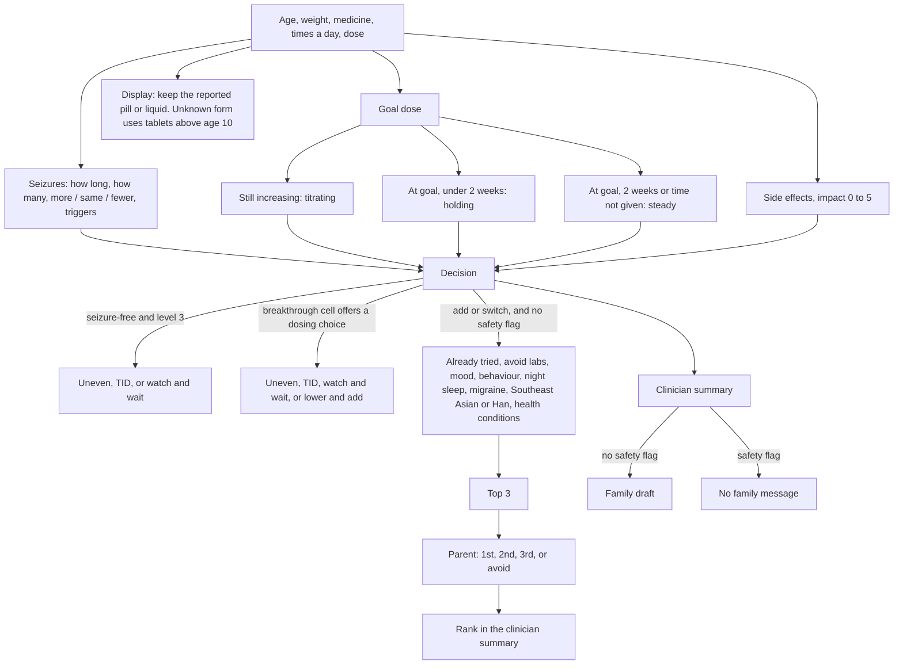

# Pediatric Epilepsy AI Medication Assistant (Aim 2)

A hybrid decision-support tool for children on anti-seizure medicines (ASMs).
A family fills in a short check-in survey between clinic visits. A rule engine
built from the PI's decision tables chooses the recommendation and every dose;
machine-learning language models read the family's free-text notes and flag
concerns for the doctor. Together they draft three things for the doctor to review:

1. a **clinical summary** for the chart,
2. a **medication recommendation** (keep the dose, increase, slow down, hold, add or
   switch), with the exact next doses from the clinician's dosing ladder, and
3. a **family message** in plain language.

Nothing reaches a family without a physician approving it. What is still
unsigned is in [`aim2_engine/NEEDS_PI_SIGNOFF.md`](aim2_engine/NEEDS_PI_SIGNOFF.md).

PI: Kristen Barbour, MD · Scripps Research. **Pre-IRB: synthetic data only.**

> **Research prototype, not a medical device.** The study has not yet received IRB
> approval, so no real patient data has been used; all patient data here is synthetic.
> The software has not been cleared or approved by any regulator and must not be used
> to make clinical decisions. Clinical values are pending the sign-off in
> `aim2_engine/NEEDS_PI_SIGNOFF.md`.

## Quickstart

Python 3.10+, standard library only - no `pip install` needed.

```bash
cd aim2_engine
python3 data/_build_asm_rules.py        # one-time: builds data/asm_rules.json
python3 clinic.py                       # app at http://127.0.0.1:8000
python3 demo.py                         # command-line demo of the engine
```

Before merging any change, all four checks should be green:

```bash
python3 -m unittest discover -s tests   # full test suite
python3 validation/harness.py           # agreement with gold cases (Cohen's kappa, target met)
python3 verification/verify_all.py      # independent proof: RESULT: PASS
python3 validation/holdout_test.py      # held-out cases + fuzz test
```

## Ground rules

Absolute; full text in [`NON_NEGOTIABLE_RULES.md`](NON_NEGOTIABLE_RULES.md).

- **Synthetic data only** - no real patient data or PHI until IRB approval.
- **Rules choose the dose and category.** ML and LLMs read free text and help with wording, never decide.
- **Physician in the loop** - every output is a draft for review.
- **When in doubt, defer** to the physician; never guess.
- **Clinical values come from the PI** - never invent or "fix" a dose, threshold or rule.

## How it works

```
family survey ──► rule engine (engine_core/) ──► summary + dose steps + family draft ──► doctor approves
                       ▲  reads                        ▲ checked by guardrails
                  data/*.json (PI's tables)       language models (nlp/): read free text, flag concerns
```

The rule engine has the final say on anything clinical; the language models only
inform the doctor. Details: [`docs/ARCHITECTURE.md`](docs/ARCHITECTURE.md).



## Where things live

| Path | What |
|---|---|
| `aim2_engine/engine_core/` | The decision engine (rules, dose ladder, tablets/liquid, outputs) |
| `aim2_engine/data/` | Clinical values as JSON, `verified` per file; generated files are edited in the `_build_*.py` builder |
| `aim2_engine/nlp/` | Language models on free text (advisory only) + guardrails |
| `aim2_engine/clinic.py` | Web app: doctor queue + family survey |
| `aim2_engine/tests/` | Test suite - every rule change needs a test |
| `kristen/` | The PI's source documents: source of truth for every clinical value |
| `docs/` | Architecture, validation plan, FDA dosing reference |

## More

- [For clinicians: how to review and send changes](docs/FOR_CLINICIANS.md)
- [Contributing: making a change safely](docs/CONTRIBUTING.md)
- [Architecture](docs/ARCHITECTURE.md) · [Data contract for the Aim 1 platform](aim2_engine/DATA_CONTRACT.md) · [Runbook](aim2_engine/RUNBOOK.md)
- [Current status and open items](aim2_engine/STATUS.md) · [Questions waiting for the PI](aim2_engine/NEEDS_PI_SIGNOFF.md)
- [Roadmap: hybrid retrieval over the clinical sources (proposed)](docs/ROADMAP.md)

## License

[Apache License 2.0](LICENSE). Copyright 2026 Sanjana Garimella and Kristen Barbour, MD;
see [`NOTICE`](NOTICE). Public release approved by the PI on 2026-10-23. The
research-use disclaimer above applies to all use.
