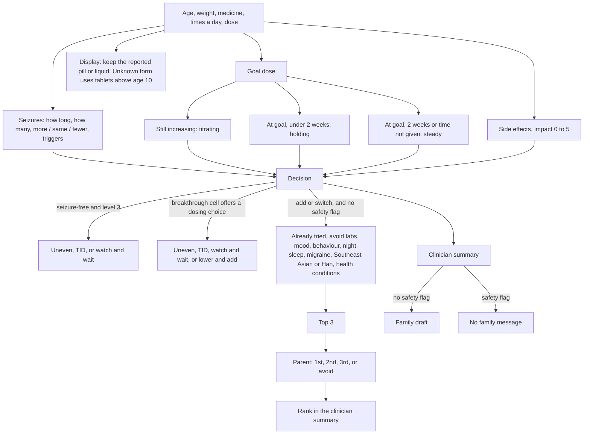

# Aim 2 - Rules-Based Medication Assistant

Auditable decision-support engine for Aim 2 of the Pediatric
Epilepsy AI Medication Assistant study (Kristen Barbour, MD). It reads a
patient's structured between-visit survey + intake context and produces three
clinician-facing **drafts**: an EHR-ready clinical summary, a medication
recommendation (with titration schedule when clinician dosing data is present),
and a draft patient message.

**Scope:** Aim 2 only. The survey-collection platform, scheduling, tokenized
links, and clinician dashboard (Aim 1) are out of scope here. This engine is
decoupled from Django so it can be unit-tested in isolation and later wired
into the Aim 1 platform or CareEvolution.

## Hard rules honored (spec §11)

- **No NLP/LLM in the decision path.** The recommendation is chosen by an
  ordered, transparent rule set over survey-derived categories. Same input →
  same output, with a machine-readable rationale.
- **No invented clinical values.** Dose ranges, rates, ceilings, interactions,
  drug classes, and the switch/add ranking are clinician-supplied. Templates
  ship empty; the populated files are transcribed from Dr. Barbour's workbooks in
  `../kristen/`. `verified` is per file. What is still unsigned is in
  `NEEDS_PI_SIGNOFF.md`.
- **No authored safety copy.** The SJS/warning text is PI-supplied. Safety flags
  always surface to the physician and are never suppressed. *(On any safety flag
  the engine gives no family message at all - Dr. Barbour's decision,
  2026-10-25, `NEEDS_PI_SIGNOFF.md` #51.)*
- **Synthetic data only** until IRB + institutional security sign-off
  (see `../NON_NEGOTIABLE_RULES.md`).

## Check-in flow



## Architecture

```
engine_core/         DETERMINISTIC decision path (no ML/NLP, no network)
  snapshot.py          input contract + §7 answer -> snapshot mapper
  asm_rules.py         ASM rule structure + loader
  categorize.py        survey -> patient status (A-E + prefs + contingency +
                       per-type breakthrough urgency tier)
  decision.py          ordered rules + PI decision tables -> category + rationale
  outputs.py           3 outputs (titration numbers ONLY from clinician data)
  dose_ladder.py       exact next-dose rungs from the PI's ladder (resolve_plan)
  med_selection.py     rule-based switch/add ranking (defers when <3 eligible)
  drug_identity.py     drug-name normalizer + same-family (annotation only)
  humanize.py          plain-language rendering of structured output
  titration_config.py  numeric thresholds loader
  version.py           ENGINE_VERSION (currently 0.4.3)
  api.py               run_engine(snapshot) -> Recommendation

nlp/                 OPTIONAL layer, OUTSIDE the decision path (points A/B/D)
  structurer.py        A: free text -> SUGGESTED fields (clinician review)
  redflags.py          B: free text -> urgent human flags (escalate-only)
  generate.py          D: template default + guarded generative-model adapter
  guardrails.py        validates generated text (blocks fabrication/contradiction)
  (+ negation, context assertion, conformal/calibration, leakage-safe eval helpers)

data/                clinician-supplied values (verified per file) + blank templates
validation/          Cohen's κ harness + metrics toolkit + gold cases
verification/        independent proof suite (verify_all.py) + red-team safety
clinician_verification/  the PI's ASM data workbook + draft rules + provenance
tests/               offline unit tests (stdlib only; transformer tests skip without torch)
tools/               maintenance scripts (dry-run by default, --apply to write)
  regen_notes.py       refresh the CACHED /review notes after an engine/format change
  seed_demo_queue.py   shape the demo queue (1 per patient, 3-4 per category)
clinic.py            local web app (doctor queue + family check-in); clinic_store.py = DB
```

An optional Django adapter for Aim 1 was considered and is **not built**; the
`django_adapter/` folder does not exist. Consume `Recommendation.to_dict()`
directly instead.

The NLP layer never feeds the decision: free-text structuring (A) is advisory,
red flags (B) escalate to humans (engine escalation is opt-in, default off),
and generation (D) only restates the engine's already-decided outputs. See the
"where NLP could enter" map shared in the project chat, and `NEEDS_PI_SIGNOFF.md`.

## Run it

```bash
cd aim2_engine
python3 -m unittest discover -s tests       # full suite, stdlib only
python3 validation/harness.py               # Cohen's κ over the 63 gold cases
python3 verification/verify_all.py          # independent proof suite -> PASS
```

No third-party dependencies are required for the engine, the NLP baselines, or
the tests. (A fine-tuned BioBERT/Bio_ClinicalBERT for A/B, a generative model
for D, or an RxNav adapter for open-world drug lookup are optional upgrades that
run on your infrastructure - see below.)

## Supplying clinician data (required before clinical use)

Populated from Dr. Barbour's workbooks in `../kristen/`. Blank `*.template.json`
files are the schema. Open sign-off is `NEEDS_PI_SIGNOFF.md`.

| File | Open | Status |
|---|---|---|
| `data/asm_rules.json` | Dose bands for the 11 ASMs | Rebuilt from the v9 ladder. Edit `_build_asm_rules.py`, not the JSON. Drug-level false for LTG concomitant bands, the three ladder flags, and CBZ/OXC |
| `data/dose_titration_ladder.json` | Per-band rungs (v9) | File `verified:true`. Three bands stay false (zonisamide ×2, brivaracetam ≥50 kg). Line check is #6 |
| `data/medication_selection_rules.json` | 9 ranked medicines + favor/avoid rules | File `verified:true` from the workbook copy. #41(a)–(e) open. Kidney-stones rule is active |
| `data/no_seizures_decision_table.json` · `data/breakthrough_decision_tables.json` · `data/breakthrough_urgency_thresholds.json` | Action grids and urgency cutoffs | File `verified:true`. Cell sign-off is #19 and #20 |
| `data/titration_thresholds.json` · initiation `switch_taper` | Cutoffs; week-4 switch reading | `verified:false` |
| `nlp/data/redflag_terms*.json` | Confirmed/expanded urgent free-text phrases | template + engine defaults; no PI-confirmed file yet |
| Drug synonyms / classes | Brand/abbreviation synonyms; ATC + mechanism classes + the "family" definition | `data/drug_synonyms.template.json` and `data/drug_classes.template.json` only - no populated file yet; `drug_identity.py` runs on built-in defaults |

```python
from engine_core import run_engine, snapshot_from_interval, DrugClassifier
from engine_core.asm_rules import load_asm_rules

rules = load_asm_rules("data/asm_rules.json")          # clinician-supplied
dc = DrugClassifier(default_by="mechanism")            # optional annotation
snap = snapshot_from_interval(patient, medication, contingency, answers)  # §7 answers
rec = run_engine(snap, asm_registry=rules, drug_classifier=dc)
print(rec.category, rec.rationale)
```

## Integration

- **Input:** build an `IntervalSnapshot` from the Aim 1 survey answers - the
  mapping from §7 question codes is in `DATA_CONTRACT.md` and
  `snapshot.survey_from_answers()`.
- **Output:** `Recommendation.to_dict()` is JSON-ready for the Aim 1 platform /
  CareEvolution.
- **Django:** an optional adapter (matching spec §5 models) was considered and is
  **not built** - no `django_adapter/` exists. Import the engine directly.
- **Reference host app:** `clinic.py` is a working stdlib example of the whole
  seam (survey → snapshot → `run_engine` → physician review → approved message).

## Upgrade hooks (optional, post-IRB + validation)

- **A/B (understanding):** swap the lexicon baselines for a fine-tuned
  BioBERT/Bio_ClinicalBERT classifier via the `FreeTextStructurer` /
  `RedFlagDetector` protocols. Encoder models cannot generate text.
- **D (generation):** inject a generative model into `GuardedGenerator`; the
  guardrails + physician review still apply, and it stays out of the decision.
- **Open-world drugs:** add an RxNav/RxClass adapter behind `DrugClassifier`.

## Validation

`validation/harness.py` reports concordance, **Cohen's κ (target ≥ 0.8)**,
weighted κ / PABAK / macro-F1 with CIs, disagreements, and safety-concern counts,
tagged with the engine version. The no-argument run defaults to the 63-case gold
set and currently reports **concordance 1.0 · κ = 1.0 (MET)** on 63/63
(engine 0.4.3), weighted κ 1.0 with 10 deferrals excluded, 5 safety-concern
outputs.

Labels are Dr. Barbour's picks on the synthetic set. Chart-review coding is
in `../docs/VALIDATION_PLAN.md`.

`verification/verify_all.py` is an independent second pass (rule/ladder proofs +
red-team safety cases) and currently reports `RESULT: PASS`
(2026-10-26: asm_rules 0 FAIL / 19 WARN, ladder 0 WARN / 17 INFO, red-team
0 misses).

**Known rough edges in the exploratory validation scripts** (not part of the unit
suite, none affecting the engine's gold-set results):

- `validation/confusion_analysis.py` **does not run** - a path bug, not missing
  data: the answer key is at
  `validation/private/INTERNAL_engine_answer_key_DO_NOT_SEND.csv` but line 32 looks
  for it at the project root.
- `validation/holdout_test.py` - the held-out oracle half passes; the fuzz half
  reports 0 crashes and 0 safety message leaks.
- `validation/creative_tests.py` - 14/14 property/boundary checks pass. In its
  informational adversarial-trap section, carbamazepine + absence raises the
  advisory note and does not change the category.
- `manual_check.py` - 37/37.
